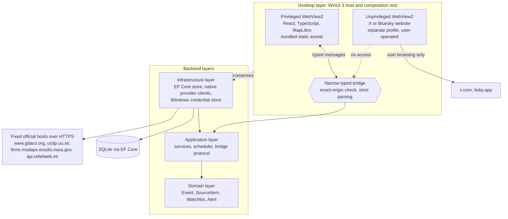

# Northern Monitor (working title)

A Windows desktop situational-awareness workstation for geopolitical and OSINT monitoring. Internal identifiers (the repository, namespaces, the executable and the data folder) use `GeopoliticalMonitor`.

## Status

- Personal project in active development.
- Contributions and pull requests are not accepted.
- Not affiliated with or endorsed by the data providers, X or Bluesky.

## What it does

- **Map and Events:** a bundled world map and an Event list showing the same collection. Events have nine categories and five severity levels, with filters for time range, minimum severity, search text and Watchlist.
- **Provider ingestion:** GDACS earthquakes and UCDP Candidate conflict events, refreshed by an in-process scheduler only while the app is open (GDACS every 30 minutes, UCDP checked every 6 hours), plus manual refresh.
- **NASA FIRMS layer:** satellite thermal-anomaly detections for the visible map area over the latest 24 hours, fetched only on request and never stored.
- **Watchlists and Alerts:** local, named collections of Events, and in-app Alerts when a GDACS refresh materially changes a watched Event.
- **ReliefWeb report attachment:** search and attach report metadata to a selected Event. Unconfigured by default, so it makes no requests.
- **Social pane:** the normal X website or the normal Bluesky website beside the map, operated by you, with no scraping. Each site can optionally host a separately verified copy of a reviewed ad blocker that you install yourself.
- **Manual X post attachment:** paste a post's URL into an Event's Sources tab. Only the URL is stored, with its time decoded locally from the post ID. Post text, author, media and engagement are not read.

## Architecture



The app is a native desktop host with an embedded web interface, so its normal runtime needs no localhost server: React loads as static assets from an application-owned virtual host. All privileged work stays in native code and is reached through one bridge of typed, schema-checked messages, which means the interface cannot choose a host or URL to request, read a provider key or run a query of its own. The backend keeps its dependencies pointing inward, and the Domain layer does not depend on the UI, databases or HTTP clients. An `Event` (a real-world occurrence) and a `SourceItem` (one piece of evidence about it) are separate records, so several sources can support one Event and a source never becomes an Event on its own. Provider refresh runs on an in-process timer that starts after the interface is ready and stops when the window closes. FIRMS detections deliberately stay out of the database: they are a transient map layer, not Events or evidence.

## Security and privacy model

- **No background presence:** no listening ports, Windows services, scheduled tasks, startup entries or background processes. The app runs only while its window is open.
- **Narrow bridge:** every message must come from the exact trusted origin (scheme, host and port) before it is parsed. Requests are a fixed set of typed messages; unknown types and unexpected fields are rejected, and there is no generic HTTP, execute or query capability.
- **Native provider networking:** requests come only from native code, to fixed HTTPS hosts, with redirects disabled, no retries, and limits per provider: GDACS 15 s and 1 MiB, UCDP Candidate 60 s and 32 MiB, NASA FIRMS 15 s and 4 MiB, ReliefWeb 15 s and 1 MiB.
- **Provider keys:** the FIRMS key is entered only in a native Windows dialog and stored in Windows Credential Manager for your Windows account, or read from the `GEOPOLITICALMONITOR_FIRMS_MAP_KEY` environment variable as a fallback. The bridge carries only key status, never the key. The key is never shown again and is not written to the database, logs or backups of the `Data` folder.
- **Isolated social pane:** X and Bluesky each run in their own browser view and profile, with web messages and host objects disabled and no connection to the privileged bridge. The app uses no X or Bluesky API, and does not scrape, read or inject anything into their pages. Nothing from Bluesky is attached to Events.
- **Unverified provider data:** Events created from provider data are marked `Unverified`, meaning the app has not independently verified them, and they are never presented as verified.
- **Local data:** Events, Sources, Watchlists, Alerts and preferences are stored in a SQLite database under `%LOCALAPPDATA%\GeopoliticalMonitor`. Provider requests happen only while the app is open, on its in-app timer or when you ask for them.

Vulnerability reports: [SECURITY.md](SECURITY.md).

## Engineering practices

- **Tests:** 1,413 automated tests at the time of writing, none of which contact a live provider.

  | Suite | Tests |
  |---|---|
  | Frontend (Vitest, 18 files) | 283 |
  | Domain (xUnit) | 77 |
  | Application (xUnit) | 793 |
  | Infrastructure (xUnit) | 260 |

  They include source guards for security rules, for example that only the app's own WebView is wired to the bridge, and that only the FIRMS client and the key store can read a key's value.
- **Builds:** zero compiler and analyzer warnings, with code-style analysis enforced in the build.
- **Documentation:** user-facing documents carry a stamp naming the commit they were last checked against; see the [documentation index](docs/README.md).
- **AI-assisted development:** development uses AI coding agents working under the repository's instruction files ([AGENTS.md](AGENTS.md), [CLAUDE.md](CLAUDE.md)), with human review and manual acceptance of every change.

## Requirements, build and run

There is no installer. The app is built from source and started from its build output.

### Requirements

- Windows on x64 (`win-x64`), platform version `10.0.17763.0` or later. The desktop project targets `net10.0-windows10.0.19041.0`.
- A .NET SDK that can build `net10.0` projects. The repository does not pin an exact SDK version.
- Node.js with npm, to build the frontend. The repository does not pin a Node.js version.
- The WebView2 Runtime installed in Windows. The app does not bundle a fixed-version runtime.
- The versions the project was built and tested with are listed under [Tested with](docs/guide/setup-and-configuration.md#tested-with).

Exact package versions and the full build steps are in [the setup guide](docs/guide/setup-and-configuration.md).

### Quick start

Build the frontend first. The desktop build copies `src/frontend/dist` into its output, so a desktop build made without it opens a blank window. From a clone of the repository:

```powershell
cd src/frontend
npm ci
npm test -- --run
npm run build
cd ../..
dotnet build src/backend/GeopoliticalMonitor.sln
dotnet test src/backend/GeopoliticalMonitor.sln
```

Start the app from the repository root:

```powershell
& ".\src\backend\GeopoliticalMonitor.Desktop\bin\Debug\net10.0-windows10.0.19041.0\win-x64\GeopoliticalMonitor.Desktop.exe"
```

The app runs only while its window is open. Closing the window ends it. On first launch it creates its folders and database, and with an empty database the Events list fills from the first provider refreshes. See [First launch](docs/guide/setup-and-configuration.md#first-launch).

### NASA FIRMS key

The fire and thermal anomaly layer needs a free NASA FIRMS MAP_KEY. Set it in the app under Settings, Data sources, with `Set key...`. The `GEOPOLITICALMONITOR_FIRMS_MAP_KEY` environment variable still works as a fallback. Without a key everything else works, and Refresh FIRMS reports that NASA FIRMS is not configured without sending a request. See [NASA FIRMS](docs/guide/setup-and-configuration.md#nasa-firms) in the setup guide.

### Troubleshooting

- **Blank window:** the frontend was not built before the desktop project. Run `npm run build` in `src/frontend`, then rebuild the desktop project.
- **Slow first launch:** a cold first launch can be slow; launches right after it are fast. This is known and not an error.
- **Social pane cut off at the right edge:** below about 1,270 px of window width the X or Bluesky pane can be clipped. This is a known open issue.

More in [the setup guide](docs/guide/setup-and-configuration.md#troubleshooting).

### Re-enrolling AdBlock

The steps for installing or re-enrolling the optional ad blocker in the X pane, and for installing it separately for the Bluesky pane, are in [the setup guide](docs/guide/setup-and-configuration.md#adblock-optional).

<!--
Screenshots: planned, not yet added. Intended files under docs/images/:

- docs/images/overview.png: overview with the map and Events
- docs/images/event-details.png: Event details
- docs/images/firms-layer.png: FIRMS layer
- docs/images/alerts.png: Alerts

The social pane must be empty or blurred in every screenshot.
-->

## Data sources and attribution

| Source | What it adds | Needs |
|---|---|---|
| GDACS | Earthquake Events | Nothing; refreshed while the app is open |
| UCDP Candidate | Monthly conflict Events, about 20 to 50 days old | Nothing; checked while the app is open |
| NASA FIRMS | Transient fire and thermal points for the visible map area, never stored | A free MAP_KEY |
| X | Posts you attach to an Event by pasting their URL | Your own X login in the X pane |
| Conflict and tension layer | Owner-curated reference areas on the map; all entries are drafts | Nothing; bundled |
| Natural Earth basemap | The bundled world map | Nothing; bundled |
| ReliefWeb | Not active (dormant by owner decision) | Nothing to set up |

Details, freshness, attribution and limits: [data sources](docs/guide/data-sources.md). Third-party components and data licences: [THIRD_PARTY_NOTICES.md](THIRD_PARTY_NOTICES.md).

## Documentation

- [User guide](docs/guide/user-guide.md): using the app.
- [Setup and configuration](docs/guide/setup-and-configuration.md): building, configuring, data locations and backups.
- [Data sources](docs/guide/data-sources.md): what each source provides and its terms.
- Architecture: [system overview](docs/architecture/system-overview.md), [data model](docs/architecture/data-model.md), [integrations](docs/architecture/integrations.md), [security](docs/architecture/security.md).
- [SECURITY.md](SECURITY.md): reporting a vulnerability.
- [Documentation index](docs/README.md): every document, its audience and what it covers.

## Copyright

Copyright (c) 2026 Oskari Turunen. All rights reserved. This repository is public for viewing; no licence is granted to use, copy, modify or distribute the code.

Third-party components and their licences are listed in [THIRD_PARTY_NOTICES.md](THIRD_PARTY_NOTICES.md).
